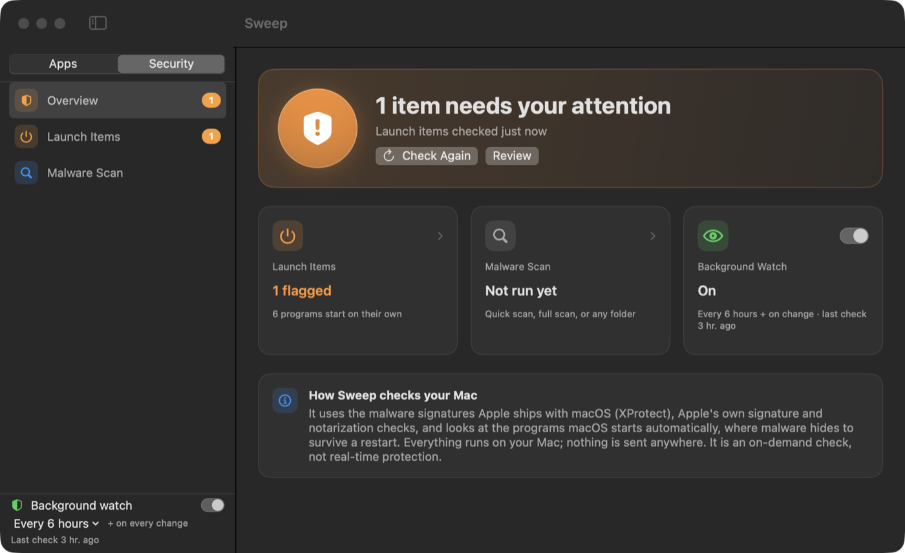
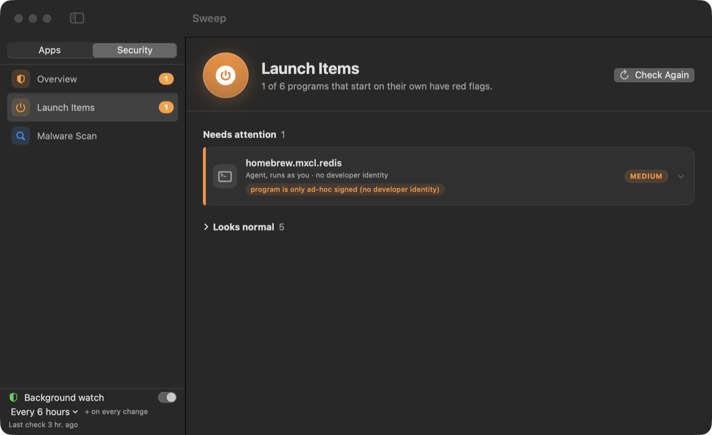
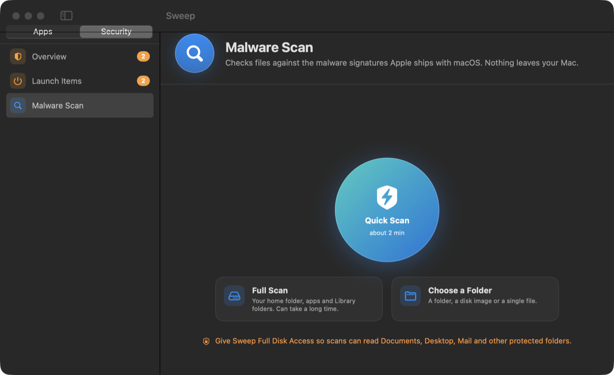

# Sweep

**An open-source app uninstaller for macOS, with built-in malware checks.** · [Website](https://jordyorel.github.io/sweep/)

Sweep removes an app *and* everything it leaves behind (preferences, caches, containers, launch agents, logs…),
always to the Trash, with Undo. It also checks your Mac the way malware actually hides: programs that start on
their own, Apple's XProtect signatures, code signatures and notarization.

Everything runs on your Mac. Nothing is uploaded, and nothing is ever deleted permanently.



## Features

**Uninstall**
- Drop an app (or pick it in the list) to see every file it left, each with the reason it matched.
- Anything that might belong to something else (a parent folder, a shared App Group) is suggested but not ticked.
- Moves everything to the Trash, with Undo (⌘Z). Files owned by the system are moved with your administrator
  password, after Sweep checks each one again, and can be put back the same way.
- A security badge for the selected app: notarized, signed by whom, quarantined, or matching known malware.

**Security**
- **Launch Items**: the programs macOS starts on its own (launch agents and daemons), with red flags such as
  hidden scripts, interpreters, world-writable locations, unsigned or ad-hoc signed programs.
- **Malware Scan**: Quick Scan (the usual hiding places, a couple of minutes), Full Scan, or any folder, disk image
  or file, using the XProtect signatures Apple ships with macOS (read at run time, so always up to date).
- **Background Watch**: a small launch agent re-checks launch items whenever one is added or changed, and on a
  schedule, and notifies you when a suspicious one appears.

This is an on-demand checker, not real-time antivirus protection.

| Launch Items | Malware Scan |
|---|---|
|  |  |

## Install

Download the latest `Sweep-<version>.dmg` from the [Releases](../../releases) page, open it and drag **Sweep** to
**Applications**. You can also [build it from source](#build-from-source).

Targets macOS 14 or later; so far it has only been tested on macOS 27.

### First launch

Sweep is not notarized by Apple yet (that needs a paid Apple Developer account, which donations would fund).
macOS therefore blocks it the first time with a message like *"Apple could not verify Sweep is free of malware"*.
To open it anyway:

1. Try to open Sweep once, then click **Done** on the warning.
2. Open **System Settings → Privacy & Security**.
3. Scroll down to the message about Sweep and click **Open Anyway**, then confirm with your password.

You only need to do this once. The source code is all here, so you can also read it or build Sweep yourself
(below) instead.

### Full Disk Access

To scan protected folders (Documents, Desktop, Mail…) and remove every leftover, give Sweep Full Disk Access:
**System Settings → Privacy & Security → Full Disk Access → +**, then choose Sweep in Applications.

## Command line

The app bundles a `sweep` command (`/Applications/Sweep.app/Contents/Helpers/sweep`):

```sh
sweep list                          # installed apps
sweep leftovers /Applications/Foo.app
sweep remove /Applications/Foo.app  # to the Trash, asks first
sweep undo                          # put the last removal back
sweep check /Applications/Foo.app   # signature, notarization, malware signatures
sweep persistence                   # launch items with red flags
sweep malware --quick               # or --full, or any paths
sweep watch --install               # background watch
```

Add `--json` to any command for machine-readable output.

## Build from source

Needs Rust and the Xcode Command Line Tools (`xcode-select --install`); Xcode itself is not required.

```sh
cargo test                     # Rust tests
macos/build-app.sh             # builds target/Sweep.app
macos/install.sh               # builds and installs it in /Applications
```

The core is Rust (`crates/sweep-core`: leftover finder and removal; `crates/sweep-malware`: XProtect scanning,
signatures, launch-item audit, background watch), exposed to the SwiftUI app (`macos/`) through a small C interface
(`crates/sweep-ffi`).

## Support

Sweep is free. If it helped you, a donation helps pay for an Apple Developer account, so Sweep can be notarized and
open without the warning above.

Donations are in crypto: see the [Donate section of the website](https://jordyorel.github.io/sweep/#donate).

## License

[MIT](LICENSE)
